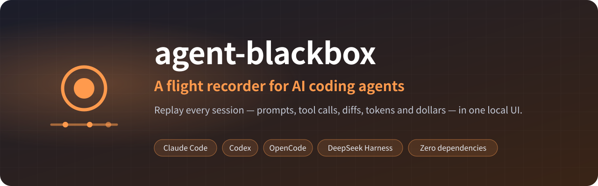
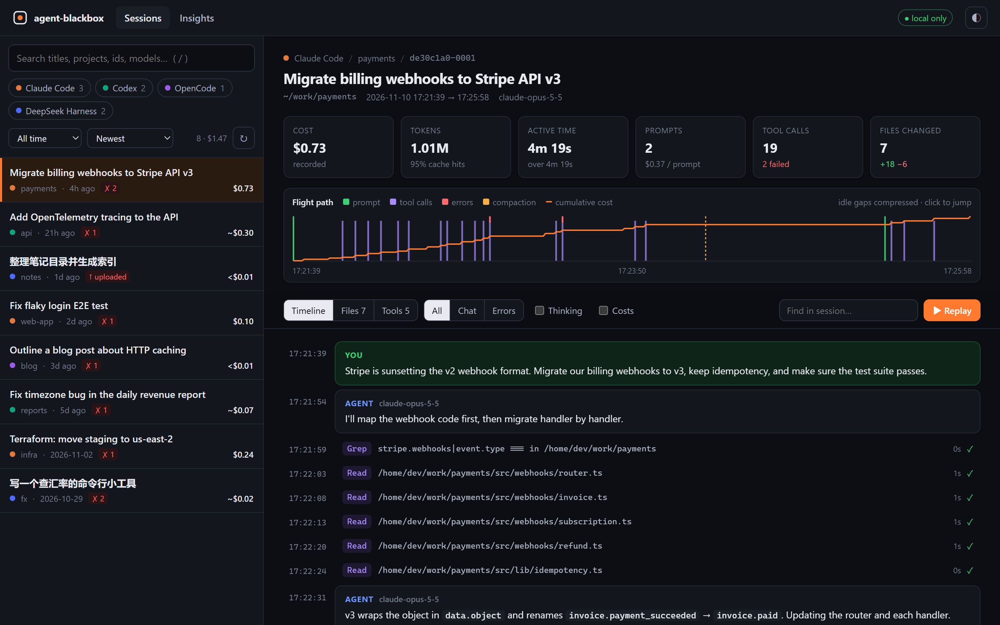
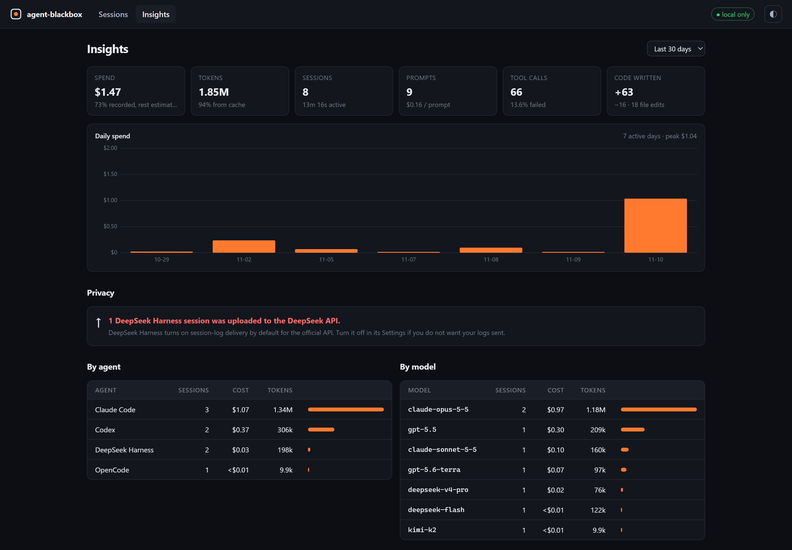
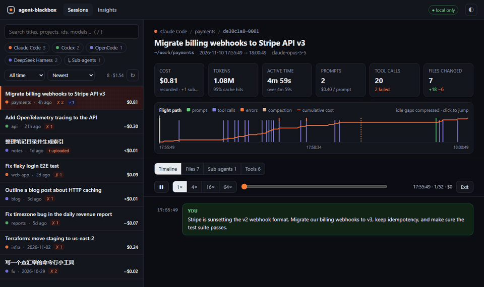

<div align="center">



<p>
<a href="https://github.com/zch6a/agent-blackbox/actions/workflows/ci.yml"></a>


<a href="LICENSE"></a>
</p>

**English** · [简体中文](README.zh-CN.md)

Replay every **Claude Code**, **Codex**, **OpenCode** and **DeepSeek Harness** session —
prompts, tool calls, diffs, errors, tokens and dollars — in one local UI.

Zero dependencies · Nothing leaves your machine · Works offline

```bash
npx github:zch6a/agent-blackbox
```



</div>

---

## Why

You let an agent run for three hours. Then:

- **What did it actually do?** Which commands failed forty times? Which files did it rewrite?
- **Where did the money go?** Which project, which model, which day — and how much was served from cache?
- **Did anything leave your machine?** DeepSeek Harness uploads session logs to the DeepSeek API by default. agent-blackbox shows you which sessions were uploaded.

Every coding agent already writes a detailed log to disk. They are just unreadable: tens of thousands of JSON lines, split across vendors, formats and folders — one of them even stores its log as thousands of concatenated zstd frames. agent-blackbox reads all of them and turns them into a timeline you can scrub through.

## Features

| | |
|---|---|
| 🛰 **One timeline, four agents** | Claude Code, OpenAI Codex (CLI & desktop), OpenCode and DeepSeek Harness, normalized into one model. |
| 📈 **Flight path** | See a whole session at a glance: prompts, bursts of tool calls, errors, context compaction and the cost curve. Idle time is compressed. Click anywhere to jump. |
| ▶️ **Replay** | Watch the session unfold step by step at 1×–64×, with a scrubber, a live clock and a running cost. |
| 🧯 **Errors mode** | One key (`e`) shows only what failed — with the prompt that led to it. |
| 📝 **Files** | Every file the agent touched, every diff, in order. |
| ⑂ **Sub-agents** | Sessions spawned by another agent (Claude Code `Agent` tasks, Codex sub-agents, DeepSeek Harness and OpenCode child sessions) are linked to the exact tool call that started them, and their cost is never counted twice. |
| 💸 **Costs you can trust** | Uses the cost the agent recorded itself, estimates whatever it did not record, and always marks estimates `~`. Duplicated usage lines are de-duplicated (a naive parser over-counts Claude Code tokens 2–3×). See [Accuracy](#accuracy). |
| 📊 **Insights** | Daily spend, cost by agent / model / project, where the time went (slowest tools), failure rates, cache hit rate, most expensive sessions. |
| 🔒 **Privacy check** | Flags DeepSeek Harness sessions whose logs were uploaded to DeepSeek. |
| 📦 **Shareable replays** | `blackbox export last --redact` writes one self-contained HTML file — sub-agents included — with API keys, tokens, e-mails and your home path scrubbed. |
| ⌨️ **Terminal-first** | `list`, `show`, `stats`, `export`, `doctor` — with `--json` for scripts. |
| ⚡ **Fast** | Logs are parsed on all CPU cores and summaries are cached. 1,041 real sessions (9.5 GB of logs, 111B tokens): about 17 s the first time, 0.3 s after that. |



**Replay** steps through a session the way it happened — the timeline fills in, the clock and running cost tick up:



No agent installed yet? `npx github:zch6a/agent-blackbox demo` opens the UI on a set of fictional sessions (the screenshots above are from it).

## Quick start

```bash
npx github:zch6a/agent-blackbox            # open the web UI (http://127.0.0.1:4777)
npx github:zch6a/agent-blackbox demo       # …or look around with fictional sample sessions first
```

Or install it:

```bash
npm i -g github:zch6a/agent-blackbox
blackbox                      # same as `blackbox ui`
```

Requires Node.js **22.15+** (it uses Node's built-in zstd and SQLite, so there is nothing else to install).

## The CLI

```console
$ blackbox list --since 7d --sort cost
ID        AGENT   WHEN      TOOK     COST  TOKENS  TOOLS        TITLE                          PROJECT
7f3a91c2  claude    2h ago   1h 12m  $18.40   41.2M    612  ⑂3 ✗9  Migrate billing to Stripe v3   payments
0c19e5d4  codex     1d ago      38m  ~$6.12    9.8M    201  ✗2     Add OpenTelemetry tracing      api
b6d2770e  deepseek  3d ago      51m  ~$0.31   12.4M    344  ↑ ✗1   整理笔记目录                   notes
```

`⑂3` means the session spawned three sub-agents, `✗9` that nine tool calls failed, `↑` that the log was uploaded to DeepSeek, `~` that the cost is an estimate.

| Command | What it does |
|---|---|
| `blackbox` / `blackbox ui` | Open the local web UI. `--port`, `--no-open` |
| `blackbox list` | Recent sessions. `--since 7d`, `--sort cost\|time\|tokens\|tools`, `-q <search>`, `-p <project>`, `-n 50`, `--all`, `--subagents`, `--json` |
| `blackbox show <session>` | Replay a session in the terminal (long output goes through `$PAGER`). `--errors`, `--thinking`, `--cost`, `--full`, `--no-tools`, `--no-pager`, `--json` |
| `blackbox stats` | Totals plus a breakdown `--by day\|week\|month\|agent\|model\|project\|tool` |
| `blackbox export <session>` | `-o replay.html`, `-f html\|md\|json`, `--redact`, `--no-subagents`, `-o -` for stdout |
| `blackbox doctor` | Which agents were found, where, and whether your Node.js supports everything |
| `blackbox demo` | The UI on fictional sample sessions. `--demo` works with every other command too |

`<session>` is a unique id prefix (like a git hash), a full id, `last`, or `-2` for the second most recent.

Global options: `-a, --agent claude,codex,opencode,deepseek` · `--root codex=/backup/.codex/sessions` · `--no-cache` · `--no-color`.

## Ask your AI assistant

agent-blackbox comes with an Agent Skill. In Claude Code:

```text
/plugin marketplace add zch6a/agent-blackbox
/plugin install agent-blackbox@agent-blackbox
```

Then ask "what went wrong in my previous session?", "what did my agents cost this month, per project?" or "make a
shareable replay of yesterday's session". The assistant runs agent-blackbox and answers from the logs. The skill keeps
it careful with them: it reads only the sessions you ask about, summarises instead of pasting logs back, and always
redacts secrets in exports. Assistants that read Agent Skills from a folder: copy
[`plugin/skills/agent-blackbox`](plugin/skills/agent-blackbox/SKILL.md) into theirs.

## Supported agents

| Agent | Where it reads from | Notes |
|---|---|---|
| **Claude Code** | `~/.claude/projects/*/*.jsonl` (or `$CLAUDE_CONFIG_DIR`) | Uses Claude Code's own `cost-state` when present. Separates human prompts from slash commands, hooks, reminders and background-task notifications. |
| **Codex** (CLI & desktop) | `~/.codex/sessions/**/rollout-*.jsonl` and `archived_sessions` (or `$CODEX_HOME`) | Reads `apply_patch` edits (also inside code-mode scripts), exit codes and de-duplicated token counts. |
| **OpenCode** | `~/.local/share/opencode/opencode.db` (or `$XDG_DATA_HOME`), plus the older `storage/` JSON layout | Read-only SQLite access; uses the cost OpenCode recorded. |
| **DeepSeek Harness** | `~/.dsh/sessions/*/session-*/session.v4.jsonl.zstd` (or `$DSH_HOME`) | Decodes the append-only multi-frame zstd log, nested `run_code` tool calls, and the session-log upload flag. |

Adding another agent is one file — see [CONTRIBUTING.md](CONTRIBUTING.md).

## Accuracy

Getting the numbers right is the point, so here is exactly how they are computed:

- **Cost.** If the agent logged its own cost (Claude Code `cost-state`, OpenCode `cost`), that number is used and labelled *recorded*. Otherwise it is *estimated* from token counts and public list prices (`~$1.23`). If a model has no known price the estimate is *partial* (`~$1.23+`). Your plan or contract may be cheaper — see [custom prices](#custom-prices).
- **Partly recorded sessions.** An agent's own accounting can start in the middle of a session: Claude Code only began writing `cost-state` in later versions, and reopening an old session starts a fresh record that covers almost nothing. Requests from before the record starts are estimated and added, and the cost is labelled *mixed*. (On one real machine, 25 of 56 sessions with a `cost-state` would otherwise have been under-reported — one by more than $1,000.)
- **Sub-agents.** Claude Code's recorded cost is process-wide, so it already includes the sub-agents it spawned while recording. Those sub-agents show *in parent* instead of a price and are left out of totals; sub-agents that ran before recording started are estimated and added.
- **Tokens.** `input` never includes cached tokens; cache reads and writes are counted separately. Claude Code repeats the same usage on every line of a split response, and Codex re-emits identical token counters — both are de-duplicated.
- **Prompts** means things a human typed. Injected context (`<system-reminder>`, `<environment_context>`, AGENTS.md, IDE context, background-task notifications, cron/loop prompts) is shown as system notes, not counted.
- **Active time** excludes idle gaps longer than 5 minutes, so a session left open overnight does not count as 14 hours of work.

## Custom prices

Create `~/.config/agent-blackbox/pricing.json` (or point `BLACKBOX_PRICING` at a file). Keys are regular expressions matched against the model id; prices are USD per million tokens:

```json
{
  "claude-opus-5": { "input": 4, "output": 20, "cacheRead": 0.4, "cacheWrite": 5 },
  "my-company-proxy-model": { "input": 0.5, "output": 1.5 }
}
```

## Privacy & security

- Reads log files **read-only**. Never modifies, moves or uploads them.
- The UI server binds to `127.0.0.1`, requires a random per-run token for every API call, and rejects requests whose `Host` header is not its own (DNS-rebinding protection).
- No telemetry, no analytics, no network requests. The UI uses no web fonts or CDNs — exported HTML files work fully offline.
- `--redact` is best-effort. Skim an export before posting it publicly.

See [SECURITY.md](SECURITY.md) to report a vulnerability.

## FAQ

**Does it work while an agent is running?** Yes. The index refreshes in the background, unfinished turns are marked *live*, and when the session you are looking at grows you get a "New activity — update" button instead of a jumping page.

**My agent keeps logs somewhere else.** Use `--root agent=path`, e.g. `blackbox --root claude=/mnt/old-laptop/.claude/projects`.

**Where is the cache?** `blackbox doctor` prints it. Delete it any time, or pass `--no-cache`.

**Windows?** Yes — Windows, macOS and Linux are all supported, and CI runs on all three.

## License

[MIT](LICENSE)
