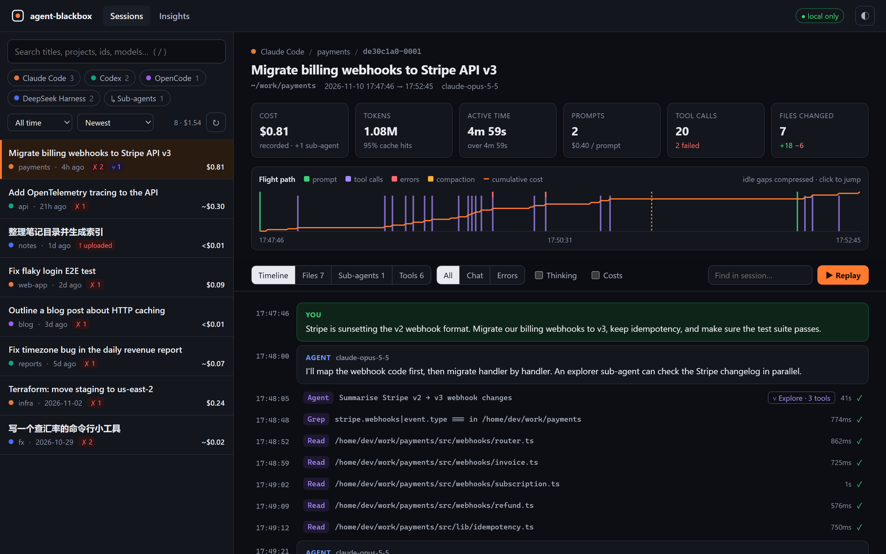
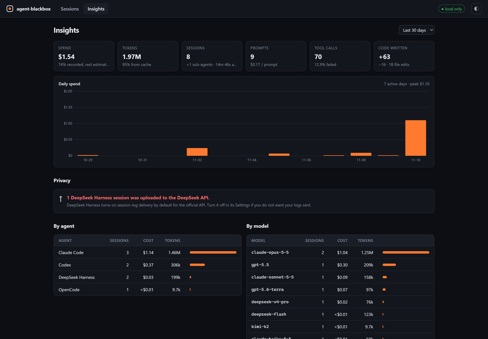

<div align="center">

# ◉ agent-blackbox

**AI 编程 Agent 的“黑匣子”。**

把 **Claude Code**、**Codex**、**OpenCode**、**DeepSeek Harness** 的每一次会话——
提问、工具调用、代码改动、报错、token 和花费——放进同一个本地界面里回放。

零依赖 · 数据不出本机 · 可离线使用

[English](README.md) · [简体中文](README.zh-CN.md)

```bash
npx agent-blackbox
```



</div>

---

## 为什么需要它

你让 Agent 跑了三个小时，然后：

- **它到底干了什么？** 哪条命令失败了四十次？改了哪些文件？
- **钱花哪了？** 哪个项目、哪个模型、哪一天？有多少命中了缓存？
- **有没有东西离开你的电脑？** DeepSeek Harness 默认会把会话日志上传到 DeepSeek API。agent-blackbox 会标出哪些会话被上传过。

每个编程 Agent 其实都在本地写了详细日志，只是没法看：几万行 JSON，格式、目录各家不同，其中一家甚至把日志存成上千个拼接在一起的 zstd 帧。agent-blackbox 把它们全部读出来，变成一条可以拖动、回放的时间线。

## 功能

| | |
|---|---|
| 🛰 **四家 Agent，一条时间线** | Claude Code、OpenAI Codex（CLI 和桌面版）、OpenCode、DeepSeek Harness，统一成同一种数据模型。 |
| 📈 **飞行轨迹** | 一眼看完整个会话：提问、工具调用的密集程度、报错、上下文压缩和累计费用曲线。空闲时间会被压缩。点哪里跳到哪里。 |
| ▶️ **回放** | 1×–64× 速度逐步重放会话，带进度条、时钟和实时累计费用。 |
| 🧯 **只看报错** | 按 `e` 只显示失败的部分，并附上引发它的那次提问。 |
| 📝 **文件改动** | Agent 碰过的每个文件、每一处 diff，按时间顺序排列。 |
| ⑂ **子 Agent** | 由其他 Agent 派生的会话（Claude Code 的 `Agent` 任务、Codex 子 Agent、DeepSeek Harness 和 OpenCode 的子会话）会关联到派发它的那次工具调用，费用绝不重复计算。 |
| 💸 **可信的费用** | Agent 自己记录了费用就直接用；估算值一律标 `~`。重复的用量行会去重（不去重的话，Claude Code 的 token 会被多算 2–3 倍）。 |
| 📊 **洞察** | 每日花费，按 Agent / 模型 / 项目拆分，最常用的工具、失败率、缓存命中率、最贵的会话。 |
| 🔒 **隐私检查** | 标出日志被上传到 DeepSeek 的 DeepSeek Harness 会话。 |
| 📦 **可分享的回放** | `blackbox export last --redact` 生成一个自包含的 HTML 文件，API key、token、邮箱和你的用户目录都会被抹掉。 |
| ⌨️ **终端优先** | `list`、`show`、`stats`、`export`、`doctor`，都支持 `--json`，方便写脚本。 |
| ⚡ **快** | 用满所有 CPU 核心解析日志，会话摘要会缓存。实测 1041 个真实会话（9.5 GB 日志、1110 亿 token）：首次约 17 秒，之后 0.3 秒。 |



还没装任何 Agent？`npx agent-blackbox demo` 会用一组虚构的示例会话打开界面（上面的截图就来自它）。

## 快速开始

```bash
npx agent-blackbox            # 打开网页界面 (http://127.0.0.1:4777)
```

或者全局安装：

```bash
npm i -g agent-blackbox
blackbox                      # 等同于 `blackbox ui`
```

需要 Node.js **22.15+**（用到 Node 内置的 zstd 和 SQLite，所以不需要安装任何其他东西）。

## 命令行

| 命令 | 作用 |
|---|---|
| `blackbox` / `blackbox ui` | 打开本地网页界面。`--port`、`--no-open` |
| `blackbox list` | 最近的会话。`--since 7d`、`--sort cost\|time\|tokens\|tools`、`-q <搜索>`、`-p <项目>`、`-n 50`、`--all`、`--subagents`、`--json` |
| `blackbox show <会话>` | 在终端里回放会话（输出较长时走 `$PAGER` 分页）。`--errors`、`--thinking`、`--cost`、`--full`、`--no-tools`、`--no-pager`、`--json` |
| `blackbox stats` | 总计，以及 `--by day\|week\|month\|agent\|model\|project\|tool` 的拆分 |
| `blackbox export <会话>` | `-o replay.html`、`-f html\|md\|json`、`--redact`，`-o -` 输出到标准输出 |
| `blackbox doctor` | 找到了哪些 Agent、在哪里，以及你的 Node.js 是否支持全部功能 |

`<会话>` 可以是唯一的 id 前缀（像 git 的哈希一样）、完整 id、`last`，或者 `-2` 表示倒数第二个。

通用选项：`-a, --agent claude,codex,opencode,deepseek` · `--root codex=/backup/.codex/sessions` · `--no-cache` · `--no-color`。

## 支持的 Agent

| Agent | 读取位置 | 说明 |
|---|---|---|
| **Claude Code** | `~/.claude/projects/*/*.jsonl`（或 `$CLAUDE_CONFIG_DIR`） | 优先使用 Claude Code 自己记录的 `cost-state`。能区分人类提问与斜杠命令、hook、系统提醒、后台任务通知。 |
| **Codex**（CLI 和桌面版） | `~/.codex/sessions/**/rollout-*.jsonl` 和 `archived_sessions`（或 `$CODEX_HOME`） | 解析 `apply_patch` 改动（包括 code mode 脚本里的）、退出码，并对 token 计数去重。 |
| **OpenCode** | `~/.local/share/opencode/opencode.db`（或 `$XDG_DATA_HOME`），以及旧版 `storage/` JSON 目录 | 只读访问 SQLite；使用 OpenCode 记录的费用。 |
| **DeepSeek Harness** | `~/.dsh/sessions/*/session-*/session.v4.jsonl.zstd`（或 `$DSH_HOME`） | 解码只追加写入的多帧 zstd 日志、`run_code` 里嵌套的工具调用，以及会话日志上传标记。 |

要支持新的 Agent，只需要写一个文件——见 [CONTRIBUTING.md](CONTRIBUTING.md)。

## 数字是怎么算的

这个工具的意义就在于数字准确，所以这里把计算方式说清楚：

- **费用**：Agent 自己记录了费用（Claude Code 的 `cost-state`、OpenCode 的 `cost`）就直接用，标为 *recorded*；否则按 token 数和公开价目表 *估算*（显示为 `~$1.23`）；有模型查不到价格时标为 *partial*（`~$1.23+`）。你的套餐或合同价可能更低，见[自定义价格](#自定义价格)。
- **只记录了一部分的会话**：Agent 自己的记账可能从会话中途才开始——Claude Code 是在较新的版本里才开始写 `cost-state` 的，而重新打开一个旧会话也会开始一份几乎什么都没覆盖的新记录。记录开始之前的请求会被估算后加进来，费用标为 *mixed*。（在一台真实电脑上，56 个带 `cost-state` 的会话里有 25 个原本会被少算，其中一个少了 1000 多美元。）
- **子 Agent**：Claude Code 记录的是整个进程的费用，所以已经包含了记录期间派生的子 Agent。这些子 Agent 显示为 *in parent*，不计入总额；记录开始之前运行的子 Agent 会被估算后加进来。
- **Token**：`input` 不含缓存部分，缓存读写单独统计。Claude Code 会在一次响应拆成的每一行里重复写同样的用量，Codex 会重复发送相同的 token 计数——两者都做了去重。
- **提问数**只统计人类真正输入的内容。自动注入的上下文（`<system-reminder>`、`<environment_context>`、AGENTS.md、IDE 上下文、后台任务通知、定时/循环任务的提示）显示为系统提示，不计入。
- **活跃时长**不计超过 5 分钟的空闲间隔，所以开了一整夜的会话不会被算成 14 小时的工作。

## 自定义价格

创建 `~/.config/agent-blackbox/pricing.json`（或用 `BLACKBOX_PRICING` 指向一个文件）。键是匹配模型 id 的正则表达式，价格单位是每百万 token 的美元数：

```json
{
  "claude-opus-5": { "input": 4, "output": 20, "cacheRead": 0.4, "cacheWrite": 5 },
  "my-company-proxy-model": { "input": 0.5, "output": 1.5 }
}
```

## 隐私与安全

- 以**只读**方式读取日志文件，从不修改、移动或上传。
- 界面服务只监听 `127.0.0.1`，每个 API 请求都要带一个每次启动随机生成的令牌，并且会拒绝 `Host` 头不是自己的请求（防 DNS 重绑定）。
- 没有遥测，没有统计，不发任何网络请求。界面不使用网络字体或 CDN，导出的 HTML 文件完全可以离线打开。
- `--redact` 只能尽力而为，公开发布前请自己再过一遍。

漏洞报告方式见 [SECURITY.md](SECURITY.md)。

## 常见问题

**Agent 还在运行时能用吗？** 可以。日志按磁盘上的现状读取，会话列表每 30 秒自动刷新（也可以点 ↻），没跑完的回合会标为 *live*。

**我的 Agent 日志在别的地方。** 用 `--root agent=路径`，例如 `blackbox --root claude=/mnt/old-laptop/.claude/projects`。

**缓存在哪？** `blackbox doctor` 会打印出来。随时可以删，或者加 `--no-cache`。

**支持 Windows 吗？** 支持。Windows、macOS、Linux 都支持，CI 在三个系统上都会跑。

## 许可证

[MIT](LICENSE)
